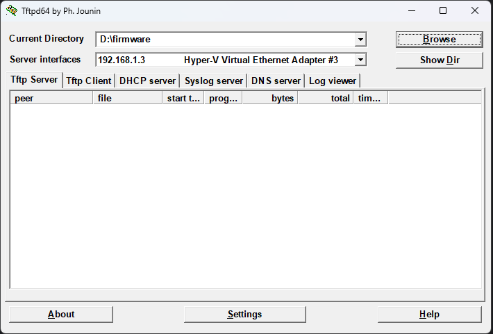
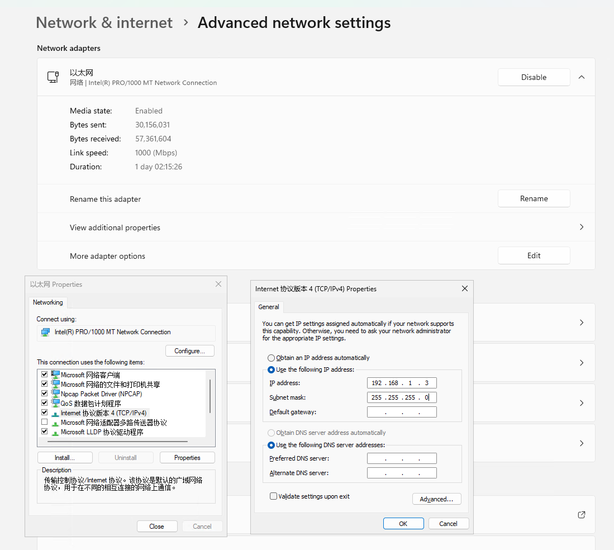
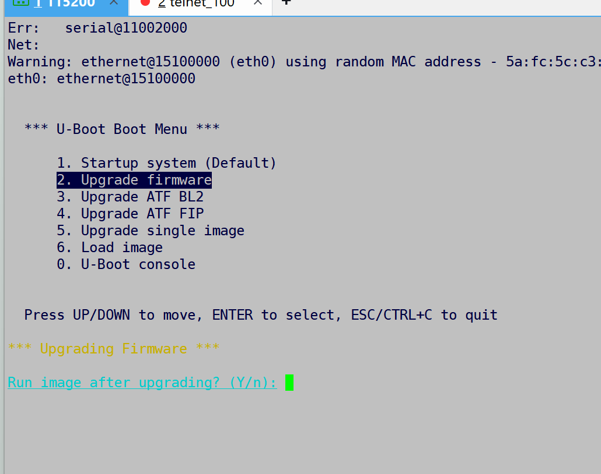
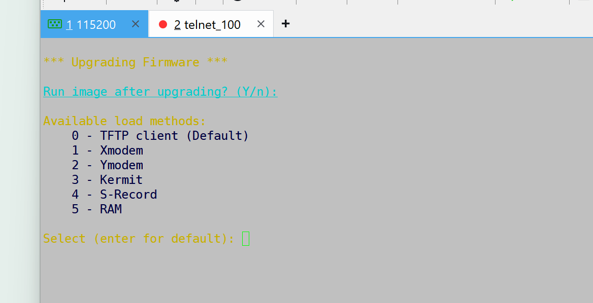
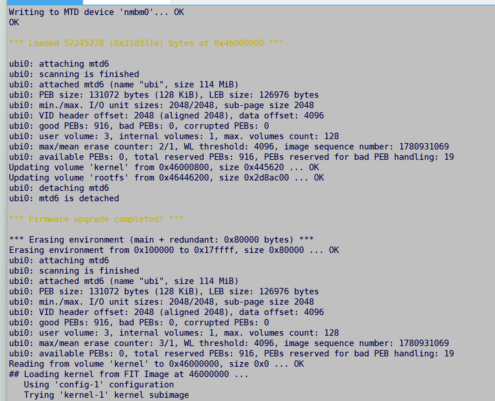

# GS-R3000N-H4 Build and Serial/TFTP Guide

This guide covers the public OpenWrt firmware images, the SDK build command,
and recovery through a board-compatible U-Boot network menu. Always use the
bootloader instructions that match the board currently being serviced.

## 1. Scope and safety

The public SDK contains Linux board support and image recipes. It does not
contain a board-specific boot chain or device data. Do not write a boot-chain
file, a raw NAND dump, or a calibration area with a firmware image.

The target uses a 128 MiB SPI-NAND device with a compatible 64 MiB UBI window.
The image limit is intentional and must not be enlarged to the physical chip
capacity.

Power must remain stable while NAND is being erased or written. If a transfer
or write reports an error, stop and retain the complete console and transfer
logs before attempting another operation.

## 2. Build the public images and SDK

Follow the official OpenWrt build-system documentation for host setup and
troubleshooting:

<https://openwrt.org/docs/guide-developer/build-system/install-buildsystem>

From the repository root, run:

```sh
./build.sh
```

The entry point loads `GS-R3000N-H4.config`, runs the standard feed commands,
resolves the configuration with `make defconfig`, builds the firmware, and
builds the SDK. Both stages use the current processing-unit count reported by
`nproc` through `-j`. The generated `.config` is temporary.

Optional modes are:

```sh
./build.sh --firmware-only
./build.sh --sdk-only
```

OpenWrt writes the results to:

```text
bin/targets/mediatek/filogic/
```

The exact image name, type, and checksum must be taken from that one build.
Do not combine files from different builds.

## 3. Image roles

| Image or archive | Use | Restriction |
| --- | --- | --- |
| `*squashfs-sysupgrade.bin` | Standard upgrade from a running matching system | Not a raw NAND image |
| `*squashfs-factory.bin` | Initial installation only when the matching bootloader requests this payload | Not a boot-chain or full-flash file |
| `*initramfs-kernel.bin` | Temporary RAM boot | Not persistent storage content |
| `*-sdk-*.tar.zst` | Package and firmware development | Never flash it to a board |

The SDK does not provide a replacement for a board-matched bootloader. Confirm
the accepted file type before selecting a U-Boot menu entry.

## 4. NAND layout

| Region | Start | End | Size | Normal update rule |
| --- | ---: | ---: | ---: | --- |
| `bl2` | `0x000000` | `0x100000` | 1 MiB | Leave unchanged |
| `u-boot-env` | `0x100000` | `0x180000` | 512 KiB | Leave unchanged |
| `Factory` | `0x180000` | `0x380000` | 2 MiB | Preserve device data |
| `FIP` | `0x380000` | `0x580000` | 2 MiB | Leave unchanged |
| `ubi` | `0x580000` | `0x4580000` | 64 MiB | Firmware content |

The NAND geometry is 2048-byte pages, 128 KiB erase blocks, and 64-byte OOB.
NMBM and UBI manage bad blocks and erase metadata. Do not use a byte-offset
procedure intended for a different flash type.

## 5. Console and network preparation

Open the serial terminal before applying power or resetting the board:

```text
115200 baud, 8 data bits, no parity, 1 stop bit, no flow control
```

Connect the board and the recovery computer to the same isolated Ethernet
segment. Use these network roles:

```text
Recovery computer: 192.168.1.3/24
Board address:     an unused address in 192.168.1.0/24
Gateway:           blank for a direct recovery link
```

The board address and the TFTP server address must be different and must not
conflict with another device.

## 6. Configure the TFTP server

Download Tftpd64 from its upstream release page:

<https://github.com/PJO2/tftpd64/releases/#release-v4.74>



Configure the TFTP server as follows:

1. Select the network adapter using `192.168.1.3`.
2. Select the directory containing the image as the TFTP base directory.
3. Confirm the exact image filename and SHA-256 value from the same build.
4. Permit the TFTP program on the isolated recovery network if the computer
   prompts for network access.

The screenshot is a visual reference. The written values and the current
build output take precedence over any path or filename visible in an image.



## 7. Select the U-Boot recovery operation

1. Start the serial terminal and TFTP server.
2. Apply power or reset the board.
3. Enter the U-Boot update menu during the boot window.
4. Select the firmware update operation that corresponds to the image type.
5. Confirm the operation only after checking the target partition and file
   checksum.



Menu wording and numbering can differ between compatible bootloader builds.
Do not select a boot-chain, single-image, or RAM-only operation unless the
bootloader instructions explicitly identify the matching file.

## 8. Enter TFTP parameters

When the loading-method screen appears, select the TFTP client method. The
exact prompt may use different labels, but the roles remain:



| Parameter | Value or rule |
| --- | --- |
| Board address | An unused address in `192.168.1.0/24` |
| TFTP server address | `192.168.1.3` |
| Netmask | `255.255.255.0` |
| Filename | The exact filename from the current build output |

The filename must be entered from the current build output rather than copied
from an old screenshot. Keep the console open throughout download, erase,
write, and the next boot.

## 9. Confirm completion

Do not remove power until the console reports a successful write and the
bootloader either continues to Linux or explicitly reports a completed
recovery. A transfer reaching 100 percent only confirms data delivery; it does
not confirm a valid NAND write or a successful boot.



After a successful boot, verify the running version and the detected partition
names before performing another update.

## 10. Update from a running OpenWrt system

If the board still starts a matching OpenWrt system, verify the checksum and
use the standard sysupgrade command:

```sh
sha256sum /tmp/<matching-sysupgrade.bin
sysupgrade /tmp/<matching-sysupgrade.bin
```

Use `sysupgrade -n` only when intentionally discarding the current system
configuration. A normal sysupgrade updates the UBI firmware content and does
not intentionally rewrite `bl2`, `FIP`, `u-boot-env`, or `Factory`.

If board detection, image compatibility, or NAND checks fail, stop. Do not
force an incompatible image or write a raw file at a guessed offset.

## 11. Failure evidence

When recovery fails, save these items before retrying:

- the complete serial log from reset to failure;
- the selected menu operation and entered network values;
- the image filename, length, and SHA-256 value;
- the TFTP transfer record and the final console error.

For host setup and general build-tool errors, use the official OpenWrt
documentation. For a board that no longer reaches its bootloader, use only a
known-good, hardware-matched recovery procedure and keep device data areas
protected.
